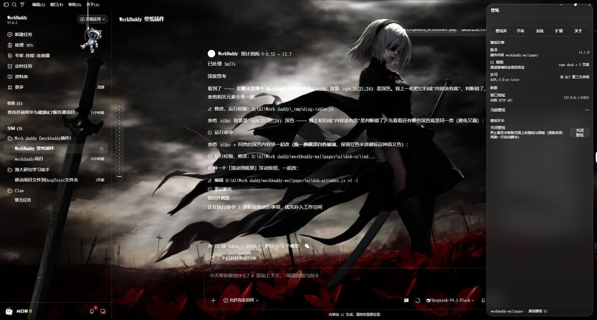
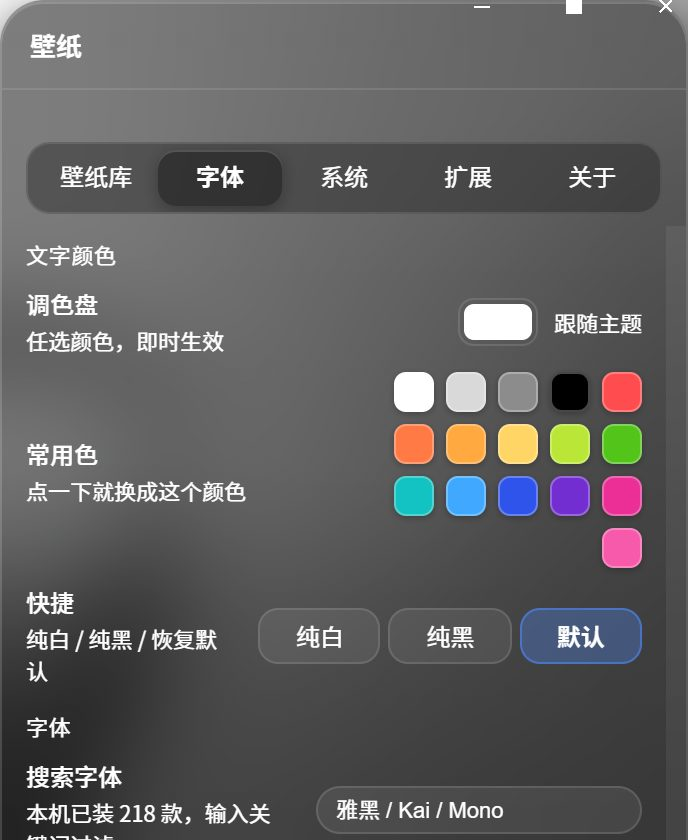

<div align="center">

# workbuddy-wallpaper

**把壁纸画进 WorkBuddy 窗口** —— 零依赖本地服务 + 注入式玻璃拟态界面

[](https://github.com/Maverick353/workbuddy-wallpaper/actions/workflows/ci.yml)


</div>

---

## 这是什么

一个**独立的本地壁纸服务 + 注入式 UI**：纯 Node 标准库实现（**零 npm 依赖**），
在本机回环端口提供完整壁纸 HTTP API，同时通过 CDP 把界面注入 WorkBuddy 窗口：

- **壁纸层**：静态图片 / 视频 / **Wallpaper Engine 场景**（随包自带实时渲染器）
- **界面层**：玻璃拟态面板（5 页签）+ 可拖拽的「拉绳吉祥物」
- **文字层**：整站文字颜色（调色盘 / 常用色块）+ 字体（**本机全部字体，可搜索**）

壁纸与 UI 都是**注入**的，不修改 WorkBuddy 安装目录，一条命令即可完全撤除。

## 截图

| 壁纸 + 玻璃面板（整站透明、无黑线） | 字体页：调色盘 + 本机字体搜索 |
| --- | --- |
|  |  |

## 特性

| 能力 | 说明 |
| --- | --- |
| 壁纸来源 | 自定义（图片 / 视频上传）、**Wallpaper Engine 创意工坊**（Steam 工坊目录直读） |
| 场景壁纸 | vendored WebWallGL 实时渲染（`.pkg`），支持鼠标交互 / 帧率 / 暂停 |
| 面板 | 壁纸库 · 字体 · 系统 · 扩展 · 关于（玻璃拟态，可拖拽吉祥物唤出） |
| 文字颜色 | 调色盘（任意色）+ 16 个常用色块，**点一下即变**；覆盖文字 / 图标 / SVG |
| 字体 | **枚举本机已装字体**（实测 218 款）可搜索；含常见中文字体别名 |
| 界面让位 | 自动把宿主深色容器 / 黑线 / 深色内容块改为透明或浅玻璃，让壁纸透出 |
| 生命周期 | 看门狗随 WorkBuddy 启停；支持开机自启；崩溃自愈；日志轮转 |
| 韧性 | 进程级异常兜底（不静默死亡）、CDP 断线主动重连、服务假死自检 |

## 环境要求

- **Windows**（依赖 `tasklist` / `taskkill` / `netstat`）
- **Node.js ≥ 18**（零 npm 依赖，无需 `npm install`）
- **WorkBuddy** 需带调试端口 `--remote-debugging-port=9222`（CDP 注入的前提）

## 下载安装

**方式一（推荐，不用 git）** —— 到 [**Releases**](https://github.com/Maverick353/workbuddy-wallpaper/releases/latest) 下载 `workbuddy-wallpaper.zip`：

1. 解压，把整个 **`workbuddy-wallpaper` 文件夹**放进 `%USERPROFILE%\.workbuddy\skills\`
2. 在该目录下执行：

```bash
node scripts/companion.js --install-autostart   # 开机自启（可选）
node scripts/start-ui.js                        # 立即启动
```

**方式二（用 git）**

```bash
git clone https://github.com/Maverick353/workbuddy-wallpaper.git
cd workbuddy-wallpaper
node scripts/start-ui.js
```

## 快速开始

```bash
# ① 起服务 + 注入 UI（Ctrl+C 退出，会自动卸载页面 UI）
node scripts/start-ui.js

# ② 只起服务、不注入（给别的程序当纯 API 用）
node scripts/start-ui.js --no-inject

# ③ 卸载页面 UI 并停服务
node scripts/stop-ui.js
```

### 装成 WorkBuddy 技能（可选）

```bash
node scripts/install.js              # 复制到 ~/.workbuddy/skills/workbuddy-wallpaper（可加 --no-autostart）
node scripts/install.js --uninstall  # 停服务 + 撤销自启 + 删目录
```

### 看门狗（随 WorkBuddy 启停）

```bash
node scripts/companion.js            # 常驻看门（5s tick）
node scripts/companion.js --status   # 四行诊断：WorkBuddy / 服务 / 端口 / CDP
node scripts/companion.js --install-autostart    # 开机自启
node scripts/companion.js --stop-service         # 手动停服务
```

打开 WorkBuddy 时自动拉起服务，关掉 WorkBuddy 时自动停服务。

## 面板：5 个页签

| 页签 | 内容 |
| --- | --- |
| **壁纸库** | 来源分段（自定义 / WE 库）、收藏星标、标签过滤、关键词搜索、上传 |
| **字体** | 文字颜色（调色盘 + 常用色块 + 纯白/纯黑/默认）、本机字体搜索与预览 |
| **系统** | 吉祥物（拉绳 Buddy）说明 |
| **扩展** | 与 WorkDaddy 联动项、数据位置 |
| **关于** | 版本 / 许可 / 接口地址 / 关闭壁纸 |

## 数据目录

`%APPDATA%\workbuddy-wallpaper` —— 主题、自定义壁纸、工坊缓存、字体缓存、
`.ui.pid`、`.companion.lock`、`companion.log`（超 1MB 自动轮转）。

## 项目结构

```
scripts/     入口：start-ui / stop-ui / companion / cdp / verify / install / server
core/        内核：store（数据）· media（媒体）· we（工坊扫描）· theme-css（背景 CSS）· fonts（字体枚举）· renderer
server/      HTTP 路由与独立启动器
ui/          注入页面：background.js（背景层）· dsh-ui/（吉祥物 + 面板 + 立绘）
renderer/    vendored 场景渲染器（WebWallGL，MIT）
assets/      内置种子壁纸
```

## HTTP API（节选）

```
GET  /api/wallpaper/health      GET  /api/wallpapers        GET  /api/custom-wallpapers
POST /api/custom-wallpapers     DELETE /api/custom-wallpapers
GET  /api/we-wallpapers         POST /api/we-apply
POST /api/theme-bg              GET/POST /api/mask
GET  /api/fonts                 （本机字体列表，?refresh=1 强制重扫）
静态  /wallpapers/* · /theme-media/* · /wallpaper-engine/scene-live/* · /wallpaper-engine/scene-files/*
```

## 兼容性与已知限制

本技能**注入宿主 UI**，因此与 WorkBuddy 的版本强耦合 —— 这几点请务必了解：

- **依赖宿主 DOM 类名**：界面透明化、去黑线等规则按 **WorkBuddy 5.8.2** 的类名编写（含 CSS-module 哈希名）。
  **宿主升级后可能失效**，需按新类名更新 `core/theme-css.js` 与 `ui/dsh-ui/index.js`。
- **需要 CDP**：WorkBuddy 必须带 `--remote-debugging-port=9222`。官方自动更新重启后可能丢失该参数
  （表现为壁纸突然消失），重启 WorkBuddy 即可恢复。
- **跨域限制**：WE 场景**自己渲染在 iframe 内**的文字 / 图形，父页 CSS 无法影响。
- **仅 Windows**：看门狗与安装脚本依赖 Windows 命令。
- **数据目录是全局的**：同一台机器上多个副本共享 `%APPDATA%\workbuddy-wallpaper`。

## 开发

```bash
node scripts/verify.js     # 自验证：起临时服务打真实请求（CI 也跑这套）
```

- 提交前请确保 `node scripts/verify.js` 全绿（CI 跑 ubuntu + windows × node 20/22）。
- **改 UI 代码后必须重启服务**：服务不热加载模块，旧进程会继续注入旧版本。
- 排查进程生死：以 `<数据目录>/companion.log` 为准，不要只看 `netstat`。

## 许可与第三方

- 本仓库：**AGPL-3.0-or-later**（见 [`LICENSE`](LICENSE)）
- 内置第三方组件与来源：见 [`THIRD-PARTY-NOTICES.md`](THIRD-PARTY-NOTICES.md)
  （webwallgl 场景渲染器 MIT；内核抽取自 [WorkDaddy](https://github.com/babygoton/WorkDaddy)）

## 免责声明

本项目通过注入方式增强本机应用界面，仅供**个人本地使用**。
请遵守你所用软件的服务条款；因使用本项目产生的任何后果由使用者自行承担。
